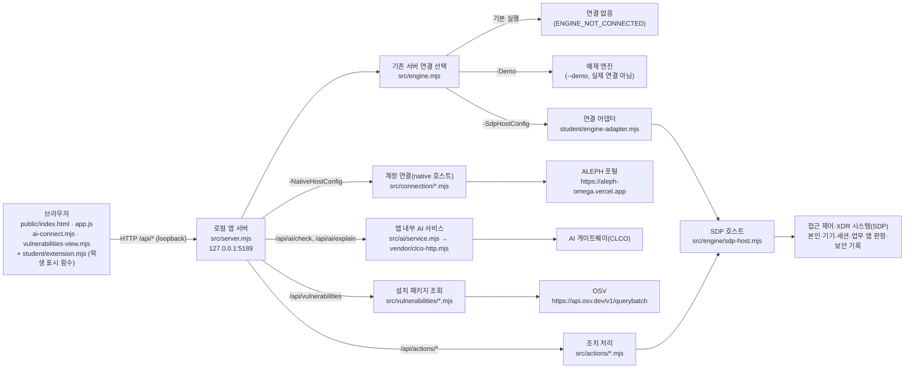

# 케셰브 실행 설명서와 시스템 구성도 (학생 작성)

이 문서는 학생이 새로 작성한 문서입니다. 시작 틀이 제공한 문서(`README.md`, `docs/STUDENT_LAUNCH_GUIDE.md`, `docs/CONNECTION_TROUBLESHOOT.md` 등)는 고치지 않았습니다.

내용을 쓸 때 근거는 세 가지로 구분합니다.

- **코드 확인**: 이 저장소의 원문을 읽고 확인한 내용
- **화면 확인**: 작성자 PC에서 실제로 실행해 본 결과
- **미확인**: 확인하지 못한 내용. 성공으로 적지 않습니다.

## 1. 목적과 기능

케셰브는 직원(학생) 본인의 로그인 상태, 업무 앱 접근 판정, 최근 접속 기록·XDR 경보, 설치 패키지의 알려진 취약점을 한 화면에서 보는 ZTNA·XDR 보안 Agent입니다. 브라우저 화면은 PC 안의 로컬 앱 서버(`127.0.0.1`)에만 연결합니다.

| 메뉴 | 보여 주는 것 | 학생 구현 함수(`student/extension.mjs`) |
|---|---|---|
| 보호 현황 | 로그인 사용자·기기·세션 | `renderIdentity` (13단계) |
| 보호 현황 | 기기·세션 빈 상태·오류, 알림, 도움정보 복사 | `renderStatus` (16단계) |
| 보호 현황 | 앱 내부 AI 연결 점검 결과 | `renderAiConnection` (17단계) |
| 보호 현황 | 설치 패키지 버전과 OSV 조회 결과 | `renderVulnerabilities` (20단계) |
| 업무 앱 | 선택한 앱 하나의 접근 판정·이유·시각 | `renderDecision` (14단계) |
| 보안 기록 | 접속 기록·XDR 경보 목록, 필터, 상세, 미지원 조치 안내 | `renderEvents` (15·16단계) |
| 보안 기록 | 근거에 연결된 AI 사건 설명 | `renderExplanation` (17·18단계) |
| 보안 기록 | 조치 요청 상태와 실제 효과 구분 | `renderAction` (19단계) |

## 2. 지원 환경과 버전

| 항목 | 값 | 근거 |
|---|---|---|
| 운영체제 | Windows (PowerShell) | 실행 도구 `tools/start-alekov.ps1`이 Windows PowerShell 스크립트입니다. 다른 운영체제에서는 실행해 보지 않았습니다(**미확인**). |
| Node.js | 22~24 지원, 기준 버전 24.19.0 | 코드 확인: `package.json`의 `"engines": {"node": "24.19.0"}`, 실행 도구가 22~24가 아니면 멈춥니다. |
| 작성자 PC의 Node.js | v24.19.0 (기준 버전과 같음) | 화면 확인: `node --version` 결과 |
| 작성자 PC의 Git | git version 2.55.0.windows.4 | 화면 확인: `git --version` 결과 |
| 작성자 PC의 PowerShell | Windows PowerShell 5.1.26100.9711 | 화면 확인: `$PSVersionTable.PSVersion` 결과 |
| 외부 npm 패키지 | 없음(0개) | 코드 확인: `package.json`에 `dependencies`가 없고 `package-lock.json`도 없습니다. `npm install`이 필요 없습니다. |
| 시작 틀 버전 | `alekov-client-starter` 0.2.11 | 코드 확인: `package.json`의 `name`·`version` |
| 브라우저 | 작성자는 Chrome에서 실행 | 화면 확인. 다른 브라우저는 **미확인** |

## 3. 폴더 구조 (실제 경로)

작성자 PC의 프로젝트 폴더(Git 최상위)는 다음과 같습니다.

```
C:\Users\Administrator\AppData\Local\ALEPH\Workbench\projects\케셰브 방어전\   ← Git 최상위(커밋·제출 기준)
└─ on-client\                       ← 앱 폴더(PowerShell을 여는 곳)
   ├─ package.json                  시작 틀 정보, npm 스크립트(start·demo·check)
   ├─ .env.example                  비밀 없는 설정 견본(실행 도구가 읽지 않음)
   ├─ tools\start-alekov.ps1        실행 도구
   ├─ src\server.mjs                로컬 앱 서버(제공)
   ├─ src\engine.mjs                기존 서버 연결 선택: 연결 없음·예제·어댑터(제공)
   ├─ src\engine\sdp-host*.mjs      SDP(접근 제어·XDR) 연결(제공)
   ├─ src\ai\*.mjs                  앱 내부 AI 서비스(제공)
   ├─ src\connection\*.mjs          계정 연결(native 호스트)(제공)
   ├─ src\actions\*.mjs             보안 조치 처리(제공)
   ├─ src\vulnerabilities\*.mjs     설치 패키지·OSV 조회(제공)
   ├─ vendor\clco-http.mjs          AI 게이트 통신(제공)
   ├─ public\index.html, app.js 등  브라우저 화면(제공)
   ├─ student\extension.mjs         ★ 학생 작성: 8개 표시 함수
   ├─ student\engine-adapter.mjs    기존 서버 연결 어댑터(시작 틀 그대로)
   └─ docs\
      ├─ STUDENT_RUNBOOK.md         ★ 학생 작성: 이 문서
      ├─ AI_EXPLAIN_ROUTE.md        ★ 학생 작성: 17단계 검토용 서버 경로 발췌
      └─ (나머지는 시작 틀 제공 문서)
```

다른 사람의 PC에서는 `C:\Users\Administrator\AppData\Local\ALEPH\Workbench\projects\케셰브 방어전` 부분이 그 사람의 워크벤치 프로젝트 경로로 바뀝니다. `on-client` 아래 구조는 같습니다.

주의: 바탕화면 등 다른 곳에 있는 `on-client` 복사본에서 실행하면 그 복사본의 옛 코드가 뜹니다. 반드시 위의 Git 최상위 아래 `on-client`에서 실행합니다.

## 4. 실행 순서

### 4-1. PowerShell을 여는 위치

1. 파일 탐색기에서 앱 폴더 `…\케셰브 방어전\on-client`를 엽니다.
2. 주소 표시줄에 `powershell`을 입력하고 Enter를 누릅니다.

또는 아무 PowerShell 창에서 아래처럼 이동합니다.

```powershell
cd "C:\Users\Administrator\AppData\Local\ALEPH\Workbench\projects\케셰브 방어전\on-client"
```

### 4-2. 실행 명령

```powershell
powershell -NoProfile -ExecutionPolicy Bypass -File .\tools\start-alekov.ps1
```

실행 도구가 하는 일(코드 확인, `tools/start-alekov.ps1`):

1. 앱 폴더와 `src\server.mjs`, `package.json`이 있는지, `package.json`의 이름이 `alekov-client-starter`인지 확인합니다.
2. Node.js 버전이 22~24인지 확인합니다.
3. 포트(기본 5189)를 다른 프로그램이 쓰는지 확인합니다.
4. 비밀로 보이는 환경변수(TOKEN·SECRET·PASSWORD·API_KEY 등)를 빼고 `node src\server.mjs`를 실행합니다.
5. `http://127.0.0.1:5189/`가 200으로 응답할 때까지 최대 20초 기다립니다.

| 옵션 | 뜻 | 작성자 확인 |
|---|---|---|
| (없음) | 기본 실행. 기존 서버·계정 연결 없음 | 화면 확인 |
| `-Demo` | 예제 자료로 실행. 실제 연결이 아님 | 화면 확인 |
| `-Port 5190` | 다른 포트로 실행 | 미확인 |
| `-Background` | 창 없이 실행 | 미확인 |
| `-NativeHostConfig "<담당자가 안내한 절대 경로>"` | 계정 연결·AI 앱 승인용 설정 | 미확인(설정 파일을 받지 않음) |
| `-SdpHostConfig "<담당자가 안내한 절대 경로>"` | 본인·기기·업무 앱 판정·보안 기록용 SDP 설정 | 미확인(설정 파일을 받지 않음) |
| `-WaitSeconds 30` | 켜짐 확인 대기 시간(1~120초) | 미확인 |

`npm start`(=`node src/server.mjs`)와 `npm run demo`(=`node src/server.mjs --demo`)도 같은 서버를 켜지만, Node 버전·포트를 미리 확인하지 않습니다(코드 확인: `package.json`). `npm run check`는 `student/extension.mjs`의 문법만 확인합니다.

### 4-3. 정상 시작 신호

PowerShell 창에 다음 줄이 나오면 서버가 응답한 것입니다(화면 확인).

```
케셰브가 켜졌습니다. 브라우저에서 http://127.0.0.1:5189/ 을 여세요.
서버가 응답한 것만 확인했습니다. AI 연결 상태는 화면에서 따로 확인해 주세요.
끄려면 이 창에서 Ctrl+C 를 누르세요.
```

이 신호는 서버가 켜졌다는 뜻일 뿐입니다. 계정 연결·AI 연결·SDP 연결 성공을 뜻하지 않습니다.

### 4-4. 브라우저 주소

```
http://127.0.0.1:5189/
```

왼쪽 메뉴 「보호 현황」「업무 앱」「보안 기록」이 보이면 화면이 열린 것입니다(화면 확인). 기본 실행에서는 위쪽 상태가 「연결 없음」이고, 각 칸에 "기존 서버·에이전트의 연결을 확인할 수 없습니다"가 보이는 것이 정상입니다. 학생 실수가 아닙니다.

### 4-5. 종료와 재실행

- **종료**: 실행한 PowerShell 창에서 `Ctrl+C`를 누릅니다. `-Background`로 켰다면 안내된 프로세스 번호의 node를 작업 관리자에서 종료합니다.
- **재실행**: 같은 앱 폴더에서 4-2의 명령을 다시 실행합니다. 실행과 종료는 프로젝트 파일을 바꾸지 않습니다.
- **코드를 고친 뒤**: 서버를 껐다 켭니다. 브라우저가 옛 파일을 보여 주면 개발자 도구(F12)를 연 채 `Ctrl+Shift+R`로 강력 새로고침합니다.

## 5. 시스템 구성도

### 5-1. Mermaid



### 5-2. 같은 내용을 글로 쓴 구성도

```
[브라우저: public/* + student/extension.mjs]
        │  HTTP, 127.0.0.1:5189 만 사용
        ▼
[로컬 앱 서버: src/server.mjs]
        ├─ /api/me, /api/apps, /api/access, /api/events, /api/devices, /api/sessions
        │     └→ src/engine.mjs
        │          ├─ 기본 실행 ............ 연결 없음(ENGINE_NOT_CONNECTED)
        │          ├─ -Demo ................ 예제 엔진(실제 연결 아님)
        │          └─ -SdpHostConfig ....... student/engine-adapter.mjs → src/engine/sdp-host.mjs → 접근 제어·XDR 시스템(SDP)
        ├─ 계정 연결(-NativeHostConfig) ..... src/connection/*.mjs → ALEPH 포털
        ├─ /api/ai/check, /api/ai/explain ... src/ai/service.mjs → vendor/clco-http.mjs → AI 게이트웨이(CLCO)
        ├─ /api/vulnerabilities ............. src/vulnerabilities/*.mjs → OSV(api.osv.dev)
        ├─ /api/actions/* ................... src/actions/*.mjs → SDP 조치(조치 설정이 있을 때만)
        └─ /api/diagnostics ................. 비밀 없는 점검 정보
```

### 5-3. 표

| 구성요소 | 파일 | 연결 대상 | 켜는 조건 | 작성자 확인 |
|---|---|---|---|---|
| 브라우저 화면 | `public/*`, `student/extension.mjs` | 로컬 앱 서버 | 항상 | 화면 확인 |
| 로컬 앱 서버 | `src/server.mjs` | 아래 모든 구성요소 | 실행 도구 | 화면 확인 |
| 기존 서버 연결 | `src/engine.mjs`, `student/engine-adapter.mjs`, `src/engine/sdp-host.mjs` | 접근 제어·XDR 시스템(SDP) | `-SdpHostConfig` | 미확인(기본은 연결 없음을 화면 확인) |
| 예제 엔진 | `src/engine.mjs`의 `demoEngine` | 없음(PC 안의 예제 자료) | `-Demo` | 화면 확인 |
| 계정 연결 | `src/connection/*.mjs` | ALEPH 포털 | `-NativeHostConfig` | 미확인(`NATIVE_HOST_DISABLED` 화면 확인) |
| 앱 내부 AI | `src/ai/*.mjs`, `vendor/clco-http.mjs` | AI 게이트웨이(CLCO) | 계정 연결·AI 앱 승인 뒤 | 미확인 |
| 패키지 조회 | `src/vulnerabilities/*.mjs` | OSV | 담당자가 조회 대상·허용 목록을 준비한 경우 | 미확인 |
| 조치 처리 | `src/actions/*.mjs` | SDP 조치 | 조치·native·SDP 설정을 모두 준 경우 | 미확인 |

비밀값(열쇠·토큰·설정 파일 내용)은 이 문서와 저장소에 넣지 않습니다. 설정 파일은 프로젝트 밖에 두고 경로만 실행 명령에 넘깁니다.

## 6. 제공 코드와 학생 작성 코드의 경계

| 구분 | 파일 | 학생이 고쳤는가 |
|---|---|---|
| 학생 작성 | `on-client/student/extension.mjs`의 8개 함수와 15단계 필터 상태(`eventFilterState`) | 예 |
| 학생 작성 | `on-client/docs/STUDENT_RUNBOOK.md`, `on-client/docs/AI_EXPLAIN_ROUTE.md` | 예(새 문서) |
| 학생 작성 | `on-client/README.md` 맨 아래 「학생 작성: 케셰브 개요」 절 | 예(기존 내용은 그대로 두고 덧붙임) |
| 제공 | `src/**`, `public/**`, `vendor/**`, `tools/**`, `student/engine-adapter.mjs`, 제공 문서 | 아니오 |

학생 함수는 제공 화면(`public/app.js`)이 넘긴 값만 읽어 `document.createElement`와 `textContent`로 DOM을 만들어 돌려줍니다. 학생 코드는 서버에 직접 요청하거나, 조치 버튼·확인 티켓을 만들거나, 파일을 쓰지 않습니다(코드 확인).

## 7. 구현한 함수와 확인 결과

| 단계 | 함수 | 하는 일 | 모의 데이터 점검 | 실제 화면 |
|---|---|---|---|---|
| 13 | `renderIdentity` | 사용자·기기·세션, loading·ok·error, 모드 안내 | 통과 | 기본 실행의 「연결 실패」 표시를 화면 확인. 정상 값 표시는 미확인 |
| 14 | `renderDecision` | idle·loading·ok·error, allow·deny·challenge·unknown, 이유·시각 | 통과 | 미확인 |
| 15 | `renderEvents` | 최신순 목록, 필터 3개, 상세, 빈 목록·실패 구분 | 통과 | 미확인 |
| 16 | `renderStatus`, `renderEvents` 상세 | 빈 상태·오류·재시도 안내, 알림, 도움정보 복사, 미지원 조치 비활성 버튼 | 통과 | 미확인 |
| 17 | `renderAiConnection` | test·verified, 모델 수, 오류 원인 구분, 수동 재점검 | 통과 | 미확인(계정 연결 설정 없음) |
| 18 | `renderExplanation` | 근거 ID 대조, 규칙, 확인 불가 상태, 제안 미실행, 근거 불일치 거부 | 통과 | 미확인(AI 연결 없음) |
| 19 | `renderAction` | 준비·전달·접수(ACK)·효과 관측·결과 불명 구분 | 통과 | 미확인(지원 조치 없음) |
| 20 | `renderVulnerabilities` | 정확한 설치 버전, OSV 결과, 미조회·일부 실패 구분 | 통과 | 미확인 |

"모의 데이터 점검"은 작성자가 jsdom으로 상태별 입력을 넣어 본 결과입니다. 실제 연결 결과가 아닙니다.

## 8. 오류별 확인 순서

| 증상(화면·창에 보이는 것) | 원인 | 확인 순서 | 근거 |
|---|---|---|---|
| `Node.js 가 없습니다` / `지금 Node.js 는 vXX 입니다` | Node 없음·버전 범위 밖 | ① `node --version` ② 22~24(기준 24.19.0) 설치 ③ 새 PowerShell 창에서 재실행 | `tools/start-alekov.ps1` |
| `포트 5189 를 다른 프로그램이 쓰고 있습니다` | 포트 충돌 | ① 그 프로그램은 그대로 둠 ② `-Port 5190`으로 실행 ③ 브라우저도 `:5190` | `tools/start-alekov.ps1` |
| `앱 폴더가 아닙니다` / `시작 틀 폴더가 아닙니다` | 실행 위치 오류 | ① `on-client` 폴더인지 ② 바로가기 폴더가 아닌지 확인 | `tools/start-alekov.ps1` |
| `…초 안에 뜨지 않았습니다` | 서버 응답 지연 | ① 창 메시지 확인 ② `-WaitSeconds 30` ③ 계속되면 메시지를 담당자에게 | `tools/start-alekov.ps1` |
| 위쪽 「연결 없음」, `ENGINE_NOT_CONNECTED` | 기존 서버 연결 설정 없음(기본 실행) | 정상 상태. 실제 연결은 담당자가 안내한 `-SdpHostConfig` 필요 | `src/engine.mjs` |
| 계정 연결 `NATIVE_HOST_DISABLED` | 계정 연결 설정 없이 실행 | 담당자가 발급한 설정 경로를 `-NativeHostConfig`로 넣어 재실행. 설정 파일을 직접 만들지 않음 | `src/server.mjs`, `docs/CONNECTION_TROUBLESHOOT.md` |
| AI 점검 `ON_AI_PROVISIONING_PENDING` | 앱 권한 준비 전 | 계정 연결·AI 앱 승인을 마쳤는지 확인. 운영자 준비 뒤 직접 재점검 | `public/app.js`의 `AI_MESSAGES` |
| AI `WB_CLCO_TIMEOUT`·`WB_CLCO_RATE_LIMITED` | 시간 초과·요청 제한 | 잠시 뒤 「현재 API 연결 점검」을 직접 누름. 자동 재시도 없음 | `public/app.js` |
| 기록·기기·세션 `CONTRACT_MISMATCH` | 응답 형식 확인 불가 | 「다시 불러오기」 한 번. 계속되면 도움정보를 담당자에게 | `public/app.js` |
| 패키지 `not_configured` / `not_checked` | 조회 대상·허용 목록 미준비 | 정상 상태. 담당자가 준비. 학생이 설정을 바꾸지 않음 | `src/vulnerabilities/*.mjs` |
| 화면이 고친 코드와 다름 | 다른 폴더의 복사본에서 실행했거나 브라우저 캐시 | ① 실행 창의 경로가 3장의 앱 폴더인지 ② F12 → Network → Disable cache → `Ctrl+Shift+R` | 작성자 경험(화면 확인) |

더 자세한 코드별 표는 시작 틀 문서 `docs/CONNECTION_TROUBLESHOOT.md`에 있습니다.

## 9. 확인하지 않은 기능(미확인)

- 실제 SDP 연결(`-SdpHostConfig`)과 그 결과: 본인 정보, 업무 앱 판정, 보안 기록. 설정 파일을 받지 않았습니다.
- 계정 연결과 AI 앱 승인(`-NativeHostConfig`), 실제 AI 연결 점검과 사건 설명. 화면에는 `NATIVE_HOST_DISABLED`가 나왔습니다.
- 실제 보안 조치 집행과 결과 재조회. 지원 조치가 없어 경로가 열리지 않으며, 시험 삼아 집행하지 않았습니다.
- 실제 OSV 조회. 조회 대상·허용 목록이 준비되지 않았습니다.
- `-Port`, `-Background`, `-WaitSeconds` 옵션과 Windows 외 운영체제.

## 10. 커밋과 제출

- 커밋·푸시는 Git 최상위(`…\케셰브 방어전`) 기준입니다. 앱 폴더에서 실행해도 같은 저장소에 커밋됩니다.
- 원격 저장소: `https://github.com/y49959946-debug/keshev-agent`
- 제출 때는 저장소 주소와 40자리 커밋(`git log -1 --format=%H`)을 입력합니다.
- 열쇠·토큰·비밀번호·설정 파일 내용은 커밋하지 않습니다.
